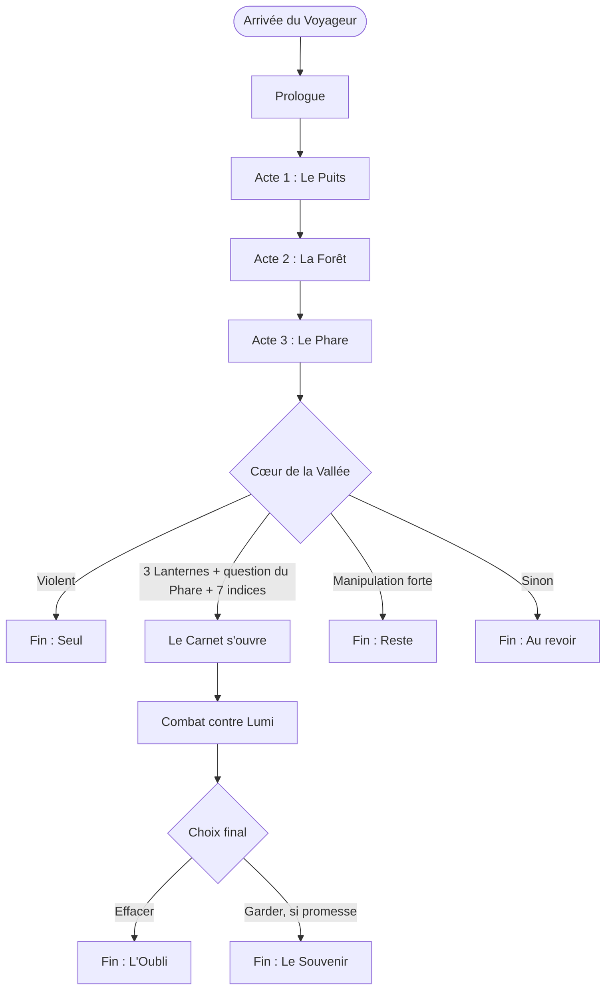

# Structure du jeu

> ⚠️ Spoilers complets. Les valeurs chiffrées sont **provisoires** et seront équilibrées en playtest.

## 1. Vue d'ensemble

Le jeu se découpe en un prologue, trois actes et un final. Chaque acte se termine par l'obtention d'une Lanterne.

| Partie | Lieu | Objectif | Boss | Temps de révélation (par défaut) |
|---|---|---|---|---|
| **Prologue** | Village de Brindille | Rencontrer Lumi, recevoir la quête | Cardon (entraînement) | Le confort |
| **Acte 1** | Brindille et le vieux puits | Première Lanterne | Le Gardien du Puits | Le confort |
| **Acte 2** | Forêt des Murmures | Deuxième Lanterne | *À définir* | Le doute |
| **Acte 3** | Ruines du Phare | Troisième Lanterne | *À définir* | La vérité |
| **Final** | Cœur de la Vallée | Réunir les Lanternes | Lumi *(vraies fins uniquement)* | La vérité |

### Le temps de révélation s'adapte au joueur

Le temps « par défaut » est celui d'un joueur qui ne manipule pas ses sauvegardes.
Un joueur qui manipule beaucoup **avance plus vite dans la révélation** : Lumi commence à commenter
ses actions dès l'acte 1, et le décor glitche plus tôt.

| Niveau de manipulation | Effet |
|---|---|
| Faible | Révélation au rythme par défaut |
| Moyen | Le doute commence dès la fin de l'acte 1 |
| Fort | Le doute commence dès le prologue, la vérité dès l'acte 2 |

## 2. Les quatre axes

Le jeu suit le joueur sur quatre axes. Trois sont liés à **une partie** (stockés dans la sauvegarde),
un est lié **au joueur lui-même** (stocké dans le Carnet de Lumi, donc il survit aux nouvelles parties).

| Axe | Stockage | Survit à une nouvelle partie ? |
|---|---|---|
| Pacifisme | Sauvegarde | Non |
| Liens | Sauvegarde | Non |
| Vérité | Sauvegarde | Non |
| Manipulation | **Carnet** | **Oui** |

### 2.1 Pacifisme

Chaque combat important peut se terminer de deux façons : **épargner** (en parlant, comme dans Undertale) ou **vaincre par la force**.

| Variable | Description |
|---|---|
| `combats_epargnes` | Nombre de combats terminés sans violence |
| `combats_vaincus` | Nombre de combats terminés par la force |
| `boss_vaincus` | Liste des boss vaincus par la force |

| État | Condition *(provisoire)* |
|---|---|
| **Pacifiste** | `combats_vaincus == 0` |
| **Mixte** | Ni pacifiste ni violent |
| **Violent** | Tous les boss vaincus par la force **et** au moins 70 % des combats vaincus par la force |

#### Tendance pendant la partie

L'état ci-dessus ne sert qu'à déterminer la fin. Pendant la partie, Lumi réagit à la **tendance** :
la part des combats terminés par la force, recalculée après chaque combat.

| Palier | Condition *(provisoire)* | Effet sur Lumi |
|---|---|---|
| Aucune | Moins de 3 combats, ou moins de 50 % vaincus | Comportement normal |
| Marquée | 50 % à 79 % vaincus | Moins de blagues, remarques inquiètes après les combats |
| Forte | 80 % et plus | Presque muette, sa lumière faiblit |

Le palier peut redescendre : un joueur qui recommence à épargner voit Lumi revenir peu à peu.

Un joueur en palier Forte qui épargne finalement un boss principal sort de la route Violente au dernier moment.
Lumi réagit à ce revirement.

### 2.2 Manipulation

Score qui augmente à chaque action méta. Il vit dans le Carnet : **recommencer une partie ne le remet pas à zéro**.

| Action | Points *(provisoire)* |
|---|---|
| Recharger une sauvegarde | +1 |
| Recharger juste après une défaite | +1 (en plus) |
| Recharger pour refaire un choix de dialogue | +2 |
| Quitter le jeu en plein combat | +2 |
| Lancer une nouvelle partie avant d'avoir vu une fin | +3 |
| Lancer une nouvelle partie **après** avoir vu une fin | +1 |

| Niveau | Score *(provisoire)* |
|---|---|
| Faible | 0 à 4 |
| Moyen | 5 à 14 |
| Fort | 15 et plus |

**Note de design :** recommencer pour découvrir d'autres fins est un comportement normal de joueur.
C'est pourquoi une nouvelle partie lancée **après** une fin coûte peu, et Lumi y réagit avec bienveillance
(« Tu reviens ! Tu veux voir ce qu'on n'a pas vu la dernière fois ? »).
Le jeu ne doit pas punir la curiosité, seulement remarquer la fuite.

### 2.3 Liens

Chaque personnage a une jauge de lien qui évolue selon les choix de dialogue et les actions.

| Personnage | Variable | Échelle |
|---|---|---|
| Lumi | `lien_lumi` | 0 à 10 |
| Ortie | `lien_ortie` | 0 à 5 |
| Cardon | `lien_cardon` | 0 à 5 |
| Mirette | `lien_mirette` | 0 à 5 |

Les liens déterminent surtout les **variantes** des fins (épilogues des personnages) et certaines scènes optionnelles.

### 2.4 Vérité

Mesure à quel point le joueur a cherché à comprendre ce qui se passe.

| Variable | Description |
|---|---|
| `indices` | Liste des indices trouvés (10 au total, voir section 3.2) |
| `question_phare` | Le joueur a posé à Lumi la question décisive aux Ruines du Phare |
| `promesse` | Le joueur a promis à Lumi de revenir (acte 3) |

## 3. Les points de décision

### 3.1 Choix majeurs

Comme dans Detroit, chaque acte contient quelques choix qui font bifurquer l'histoire.

| Acte | Moment | Options | Effets |
|---|---|---|---|
| Prologue | Lumi donne le numéro 247 | Accepter / Demander « Pourquoi 247 ? » | Demander : indice n°1, `lien_lumi` +1 |
| Prologue | Combat d'entraînement contre Cardon | Le ridiculiser / L'encourager / Perdre exprès | Encourager : `lien_cardon` +2 ; Perdre exprès : `lien_cardon` +1, réplique spéciale |
| Acte 1 | Registre de Mirette | Lire la ligne raturée / L'ignorer | Lire : indice n°2 (seulement si une ligne a été raturée, donc après un rechargement) |
| Acte 1 | Le Gardien du Puits | Lui rappeler ce qu'il protège / Le vaincre | Épargner : `combats_epargnes` +1 ; Vaincre : ajouté à `boss_vaincus` |
| Acte 2 | Lumi s'égare dans la forêt | Partir la chercher / Continuer seul | Chercher : `lien_lumi` +3, scène clé ; Continuer : `lien_lumi` −2, Lumi revient d'elle-même, plus froide |
| Acte 2 | Confidence d'Ortie | L'écouter jusqu'au bout / Écourter | Écouter : indice n°5, `lien_ortie` +2 |
| Acte 3 | Question au Phare | Demander à Lumi « Qu'est-ce que la Brume ? » | Débloque `question_phare` si au moins 5 indices trouvés |
| Acte 3 | Lumi demande « Tu reviendras ? » | Promettre / Se taire / Dire non | Promettre : `promesse = true`, `lien_lumi` +2 ; Dire non : `lien_lumi` −3 |

### 3.2 Les indices

Dix indices sont dispersés dans le jeu. Certains n'apparaissent **que** si le joueur a manipulé ses sauvegardes :
le joueur qui triche découvre la vérité plus vite, mais au prix de la confiance de Lumi.

| N° | Indice | Où | Condition particulière |
|---|---|---|---|
| 1 | Pourquoi 247 | Prologue, dialogue avec Lumi | — |
| 2 | La ligne raturée | Registre de Mirette | Avoir rechargé au moins une fois |
| 3 | La tisane d'Ortie | Maison d'Ortie | Deuxième partie ou plus |
| 4 | Les gravures du puits (246 traits) | Fond du puits | — |
| 5 | Confidence d'Ortie | Acte 2 | Écouter jusqu'au bout |
| 6 | Le carnet de croquis d'un Voyageur précédent | Forêt, lieu caché | — |
| 7 | L'arbre qui « n'a pas encore poussé » | Forêt | Avoir rechargé dans la forêt |
| 8 | Le journal du gardien du Phare | Ruines du Phare | — |
| 9 | La lumière du Phare qui clignote 247 fois | Ruines du Phare, la nuit | — |
| 10 | Le dernier mot du Premier Voyageur | Cœur de la Vallée | `lien_lumi` ≥ 7 |

## 4. Conditions des fins

Les conditions sont évaluées **dans cet ordre** : la première qui est remplie détermine la fin.

| Ordre | Fin | Condition *(provisoire)* |
|---|---|---|
| 1 | **Seul** | État de pacifisme = Violent |
| 2 | **L'Oubli** ou **Le Souvenir** *(vraies fins)* | 3 Lanternes + `question_phare` + au moins 7 indices + état ≠ Violent |
| 3 | **Reste** | Manipulation = Forte |
| 4 | **Au revoir** | Par défaut |

### 4.1 Seul

Le joueur a tout résolu par la force. Lumi parle de moins en moins au fil des actes, sa lumière faiblit.
Au Cœur de la Vallée, les Lanternes chassent bien la Brume… et le village avec. Lumi s'éteint sans un mot.

- **Variante** : si `lien_lumi` ≥ 7 malgré tout, Lumi reste allumée et dit une dernière phrase au joueur avant le noir.

### 4.2 Les vraies fins

Le Carnet s'ouvre. Commence le combat final contre Lumi : on ne peut pas la blesser, seulement esquiver ses souvenirs
et lui parler. Plus le score de manipulation est élevé, plus Lumi a de souvenirs du joueur à lui « lancer ».

À la fin du combat, le choix :

| Choix | Disponible si | Fin |
|---|---|---|
| Effacer le Carnet | Toujours | **L'Oubli** |
| Laisser Lumi se souvenir | `promesse == true` | **Le Souvenir** |

- **L'Oubli** : Lumi est libérée de sa mémoire. Au lancement suivant, elle se présente comme si c'était la première fois. Un seul indicateur caché survit (voir section 6).
- **Le Souvenir** : Lumi garde tout. Au lancement suivant, elle accueille le joueur en se souvenant de lui, de leur histoire, et de la promesse.

### 4.3 Reste

Le joueur a beaucoup manipulé sans chercher à comprendre. Au Cœur de la Vallée, Lumi panique :
elle refuse que l'histoire se termine. Mise en scène : faux écran de fin qui recommence, fausse fenêtre
« Quitter ? » qui se dérobe, dialogue où Lumi supplie.

**Règle absolue** : le jeu ne bloque jamais réellement la fermeture. La fenêtre peut toujours être fermée normalement, et le menu « Quitter » fonctionne à la deuxième tentative.

### 4.4 Au revoir

Le joueur a fini le jeu honnêtement, sans percer le secret. Les Lanternes « chassent » la Brume,
Lumi remercie le joueur, sa lumière est jaune et calme. Elle le laisse partir.
C'est la fin la plus douce, et la plus triste pour qui connaît la vérité.

### 4.5 Variantes par personnage (épilogues)

Toutes les fins sauf **Seul** se terminent par de courts épilogues, à la manière des appels de fin d'Undertale :

| Personnage | Épilogue si lien élevé (≥ 3) | Épilogue si lien faible |
|---|---|---|
| Ortie | Elle plante un arbre en l'honneur du Voyageur | Elle oublie déjà son nom |
| Cardon | Il raconte (en exagérant) ses aventures avec le Voyageur | Il se vante d'avoir battu le Voyageur |
| Mirette | Elle garde une page de son registre au nom du Voyageur | Elle reprend ses affaires comme si de rien n'était |

## 5. Arbre des fins

## 6. Ce qui survit après une fin

| Fin vue | Au lancement suivant |
|---|---|
| Au revoir | Lumi : « Tu es revenu… Je ne pensais pas te revoir. » |
| Reste | Lumi est gênée, s'excuse à moitié de sa réaction |
| Seul | Lumi est absente du premier dialogue, elle n'apparaît qu'après quelques secondes de silence |
| L'Oubli | Le Carnet est vidé. **Un seul indicateur caché** est conservé : `oubli_fait`. Il ne sert qu'à l'hésitation de Lumi sur le numéro au premier dialogue |
| Le Souvenir | Lumi se souvient de tout et accueille le joueur par son ancien numéro |

## 7. L'écran d'embranchements

Après chaque fin, un écran à la manière de Detroit montre le parcours du joueur :

- Chaque acte est une colonne, chaque choix majeur un nœud
- Les chemins pris sont éclairés, les chemins non pris restent grisés avec « ??? »
- Un pourcentage de découverte global est affiché
- Les fins déjà vues sont listées

Cet écran est **stocké dans le Carnet**, il cumule donc toutes les parties du joueur.
Dans l'univers, c'est une page du Carnet de Lumi : elle aussi garde une trace de tous les chemins.

## 8. Points ouverts

- Boss des actes 2 et 3
- Nombre et contenu des combats secondaires
- Équilibrage de tous les seuils
- Faut-il une fin cachée supplémentaire (par exemple, ne jamais adresser la parole à Lumi) ?
